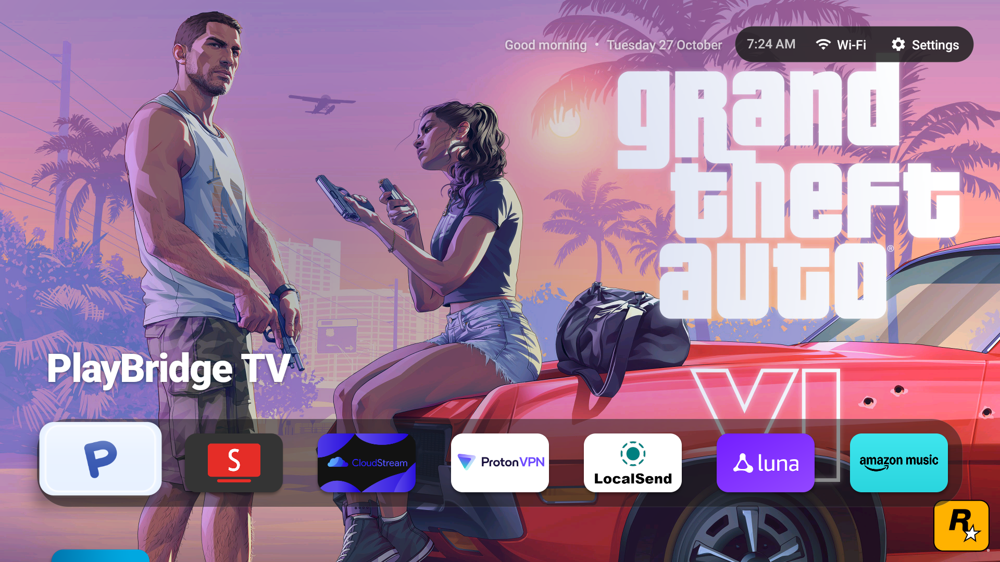
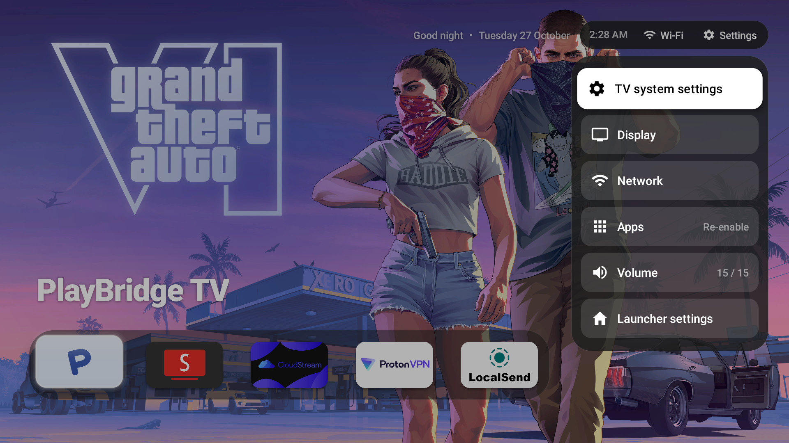
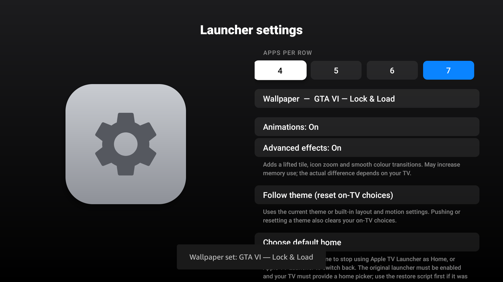

# FireDock 🚀

<p align="center">
  
</p>

<p align="center">
  <strong>The macOS-inspired Dock + tvOS Glass Experience for Amazon Fire TV & Android TV</strong>
  <br>
  <em>Zero-delay Home button takeover • Live Control Center with Volume • Built-in GTA VI & Space Wallpapers • 100% Ad-Free</em>
</p>

---

## ✨ Features

- 🍏 **macOS-Style Bottom Dock:** Pinned favorites along the bottom edge, just like the macOS dock, with fluid glass highlights and spring animations.
- ⚡ **Zero-Delay Home Button Interception:** Utilizes a dedicated `TYPE_ACCESSIBILITY_OVERLAY` window architecture to completely eliminate Fire OS's 5-second third-party home launch throttle. Pressing Home returns instantly without flickering Amazon's stock home screen.
- 🎛️ **tvOS Control Center & Inline Volume Controls:** Open Quick Settings using the remote's Settings key or the top menu bar to adjust system volume directly with D-Pad Left/Right, with immediate shortcuts to Wi-Fi, Display, and TV system settings.
- 🖼️ **Built-in Wallpaper Gallery:** Includes curated high-resolution wallpapers:
  - GTA VI (Official Cover, Lucia & Jason, Lock & Load, Album Cover)
  - Space & Nature (Earthrise, Aurora Borealis, City Lights, Southern Lights, Sunrise from Orbit)
  - One-click instant wallpaper picker with zero lag.
- 📶 **Native Wi-Fi & System Settings Integration:** Wi-Fi status pill and Quick Settings directly integrate with Fire TV's native settings without crashes or unsupported intent errors.
- 🛡️ **Ultra-Fast & Privacy-Focused:** Zero telemetry, zero analytics, zero ad injection, and low memory footprint (~11 MB with all assets bundled).

---

## 📸 Screenshots

| tvOS Control Center with Volume | Single-Click Wallpaper Picker |
|:---:|:---:|
|  |  |

---

## 🛠️ Installation via ADB

Connect your computer to your Fire TV over Wi-Fi or USB:

```bash
# 1. Connect to Fire TV
adb connect <FIRE_TV_IP>:5555

# 2. Install FireDock APK
adb install -r app-debug.apk

# 3. Enable Accessibility Service (for instant Home button interception)
adb shell settings put secure enabled_accessibility_services com.appletv.launcher/.HomeKeyService
adb shell settings put secure accessibility_enabled 1

# 4. Launch FireDock
adb shell am start -n com.appletv.launcher/.MainActivity
```

---

## 🕹️ Remote Navigation

| Remote Button | Action |
|---|---|
| **Home** | Instantly launches / returns to FireDock home screen (zero delay) |
| **Settings** | Opens tvOS Control Center with live volume controls & shortcuts |
| **D-Pad Left / Right (on Volume row)** | Decreases / Increases volume (`◀ ▶`) |
| **D-Pad Center (OK)** | Opens app / Confirms selection |
| **Back** | Closes panels / returns to launcher |

---

## 🏗️ Building from Source

Requirements:
- Android Studio / JDK 17+
- Android SDK 34

```bash
git clone https://github.com/tonysebastine/FireDock.git
cd FireDock
./gradlew assembleDebug
```

---

## 📄 License

MIT License. See [LICENSE](LICENSE) for details.
